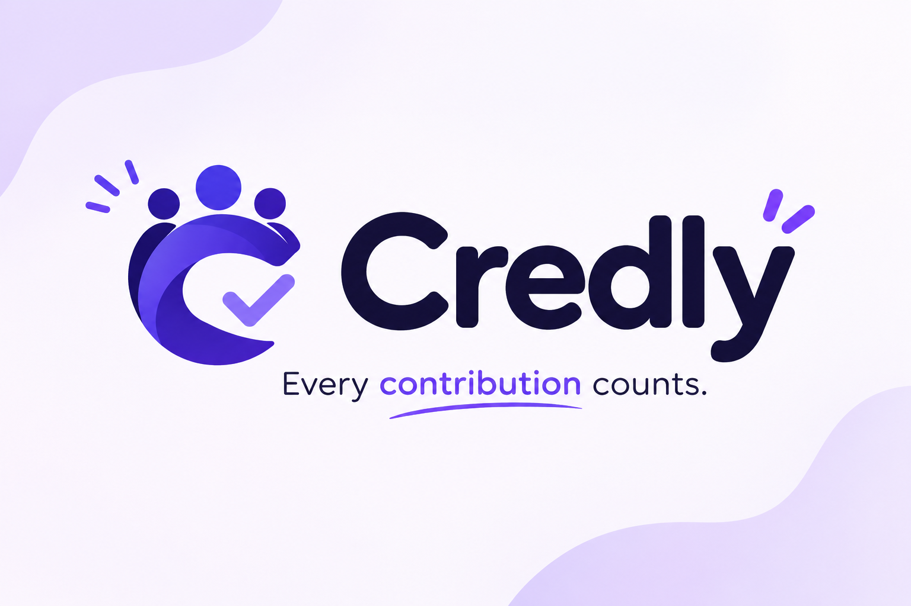

# Credly: Group Contribution Tracker

> **"Credly: fair credit for every contributor. Designed and built by Pratik Panda."**



Credly is a modern, mobile-first web app (PWA) designed to solve group project inequality in student and collaborative teams. In many groups, one or two people do the majority of the work while others claim equal credit. Credly provides a transparent, peer-reviewed ledger where every member logs what they did, teammates verify whether it helped the group or them, and the platform turns this into a fair, mathematical "share of work" donut chart and detailed analytics.

---

## 🌟 Core Loop
1. **Post what you did** $\to$ Record tasks big or small (with 1 base point and character validations).
2. **Teammates review it** $\to$ Team members answer *"Was this helpful?"* with **For the group**, **For me**, or **No** (with a mandatory written explanation).
3. **See the fair share** $\to$ Home displays the real-time share-of-work donut chart, while Analytics breaks down ratios, volume, and timelines.

---

## 📐 Scoring System

Credly supports two mathematical scoring modes, configured per team via the **"Weight by number of posts"** setting (Admin toggle in team details):

### Mode 1: Quality-Based Scoring (Default, Setting OFF)
Measures the average helpfulness per contribution.
- For each member:
  $$\text{total\_upvotes} = \text{GROUP votes} + \text{SELF votes received across all their posts}$$
  $$\text{member\_score} = \frac{\text{total\_upvotes}}{\text{total\_posts}}$$
  *(If $\text{total\_posts} = 0$, then $\text{member\_score} = 0$)*

### Mode 2: Volume-Weighted Scoring (Setting ON)
Allows members who contribute a higher volume of approved work to earn a larger share:
- For each member:
  $$\text{member\_score} = \text{total\_upvotes}$$

### Share Calculation (Both Modes)
$$\text{total\_score} = \sum \text{member\_scores}$$
- If $\text{total\_score} > 0$:
  $$\text{member\_share} = \left(\frac{\text{member\_score}}{\text{total\_score}}\right) \times 100\%$$
- If $\text{total\_score} = 0$: The application displays an honest **"No chart yet"** empty state instead of a misleading equal split.

### Voting Rules:
- **GROUP** = $+1$ upvote.
- **SELF** = $+1$ upvote.
- **NO** = $0$ upvotes, requiring a written note of $\ge 5$ characters.
- **Pending votes** do not count until peer-reviewed.
- **Self-voting is strictly blocked**.
- Each teammate can review each post only once.

---

## 🛠️ Tech Stack
- **Frontend**: React 19 + Vite + TypeScript, Tailwind CSS, Framer Motion, Recharts, Lucide React icons, TanStack Query v5, React Hook Form + Zod.
- **Backend**: Node.js + Express (TypeScript), Prisma ORM, Argon2 password hashing, JWT in `httpOnly` secure cookies with refresh tokens, Server-Sent Events (SSE) for realtime synchronization.
- **PWA**: Installable web manifest, offline shell service worker, custom app icon.
- **Default Theme**: Default Dark Mode (`#131513` / `#1e201d` with purple/indigo accents matching `logo.png`) with instant light mode toggle.

---

## 🚀 Getting Started

### Prerequisites
- Node.js (v18+)
- npm (v9+)

### Installation
1. Clone or open the repository:
   ```bash
   cd TeamProof
   ```
2. Install dependencies:
   ```bash
   npm install
   cd server && npm install && cd ..
   cd client && npm install && cd ..
   ```

3. Setup environment variables:
   ```bash
   cp .env.example server/.env
   ```

4. Initialize the database:
   ```bash
   npm run prisma:push --prefix server
   ```

5. (Optional) Seed the demo team:
   ```bash
   npm run prisma:seed --prefix server
   ```

### Running the App
Start both frontend and backend concurrently:
```bash
npm run dev
```
- Frontend: [http://localhost:5173](http://localhost:5173)
- Backend API: [http://localhost:5000](http://localhost:5000)

---

## 🧪 Testing

### Unit Tests (Vitest)
Executes scoring formulas (Quality vs Volume modes, zero-posts, zero-upvotes edge cases), duplicate post detection, and vote validation rules:
```bash
npm run test
```

### End-to-End Tests (Playwright)
Validates complete user journeys (Signup $\to$ Walkthrough $\to$ Create Team $\to$ Post $\to$ Vote with reason $\to$ Switch Teams $\to$ Share Code $\to$ Logout):
```bash
npx playwright test
```

---

## 📱 Navigation & Screens

1. **Home**: Team name with Switch button $\to$ Share-of-work Donut chart (or "No chart yet") $\to$ Review banner ($N$ posts need your review) $\to$ "What did you do for the group?" post box.
2. **My Work**: Post box plus exclusively your own contributions, upvote split (`⭐ 1 base`, `👍 upvotes`, `👥 group`, `🙋 me`, `👎 downvotes`), details toggle for downvote reasons, and pending reviews count.
3. **Contributions**: Full team feed newest first with filter chips (**All**, **Needs my review**, **Mine**), interactive voting buttons, and inline reason prompt.
4. **Analytics**: Summary tiles, member breakdown cards with share progress bars, active scoring mode banner, and contribution-over-time area chart.
5. **My Teams**: Clean project list with member/post counts $\to$ Tapping opens details (rename team, join code with non-disruptive share button, weight-by-posts setting toggle, members roster, and leave team).
6. **Share code**: Uses Web Share API or clipboard with toast notifications without disrupting typed text.
7. **Login/Logout**: Secure session termination.

---

## 👤 Credit and Attribution

**"Credly: fair credit for every contributor. Designed and built by Pratik Panda."**
